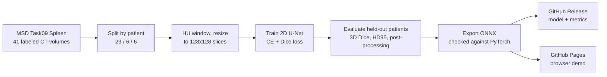

# CT Segmentation in the Browser

**A U-Net that segments the spleen in abdominal CT, trained and evaluated per patient in GitHub Actions, and deployed as a web app that runs the model on the visitor's own device with ONNX Runtime Web.**

[](https://github.com/Dhruvsanghavi07/ct-segmentation-web/actions/workflows/ci.yml)

**Live demo: https://dhruvsanghavi07.github.io/ct-segmentation-web/** · pick a held-out test patient, scroll through the spleen, and compare the model's prediction with the radiologist's label. No server is involved and no image leaves the browser.

<!-- RESULTS -->

## Pipeline



All of it runs in one GitHub Actions workflow (`.github/workflows/train.yml`) on a standard CPU runner, so anyone can reproduce a run from the Actions tab.

| Step | File | Details |
|---|---|---|
| Data | `medseg/data.py` | Patient-level split (adjacent slices are near-duplicates, so a slice-level split leaks), soft-tissue window [-160, 240] HU, radiology orientation (patient's left on the image right), slices resized to 128×128. Training keeps every slice with spleen plus 25% of empty slices. |
| Model | `medseg/model.py` | 2D U-Net, 4 levels (16 to 128 channels), batch norm, transposed-conv upsampling. Only operators that ONNX Runtime Web supports. |
| Training | `medseg/train.py` | Cross-entropy + soft Dice loss (the spleen is a few percent of each slice), AdamW, cosine schedule, anatomy-safe augmentation (shifts and intensity jitter, no left-right flips), early stopping on validation 3D Dice. |
| Evaluation | `medseg/evaluate.py`, `medseg/metrics.py` | Per-patient 3D Dice and HD95 in millimetres, with and without largest-connected-component post-processing. |
| Export | `medseg/export.py` | ONNX export, then a parity check on real test slices: the build fails if logits differ by more than 1e-3 or any pixel's class changes. |
| Demo | `web/` | Plain HTML/JS with ONNX Runtime Web (WebAssembly). Shows prediction overlay, label outline, per-slice Dice and inference time. |

## Run it locally

```bash
python -m venv .venv && source .venv/bin/activate
pip install torch==2.5.1 --index-url https://download.pytorch.org/whl/cpu
pip install -e ".[dev]" onnx==1.17.0 onnxruntime==1.20.1
pytest -q                                   # unit tests on synthetic data, ~1 minute

# full pipeline (downloads 1.5 GB)
curl -fL -o spleen.tar https://msd-for-monai.s3-us-west-2.amazonaws.com/Task09_Spleen.tar && tar -xf spleen.tar -C data
python -m medseg.data data/Task09_Spleen --out data/processed
python -m medseg.train data/processed --out runs/latest
python -m medseg.evaluate data/processed runs/latest/best.pt --out runs/latest --samples web/samples
python -m medseg.export runs/latest/best.pt data/processed --out web/model.onnx
python -m medseg.report runs/latest --web web
python -m http.server -d web 8000             # open http://localhost:8000
```

## Tests

`pytest -q` covers the metrics against hand-computed answers (Dice, HD95 with anisotropic spacing, connected components), the patient split (disjoint, complete, deterministic), preprocessing on synthetic NIfTI volumes, training until the model learns a synthetic organ, evaluation, and ONNX-vs-PyTorch parity.

## Limitations

See [MODEL_CARD.md](MODEL_CARD.md). In short: six test patients from one hospital, 2D slices at reduced resolution, and **not for clinical use**.

## License and data

Code: MIT. Data: Medical Segmentation Decathlon Task09 Spleen (CC-BY-SA 4.0); the demo's sample slices come from held-out test patients and are shared under the same license.
